<h1 align="left">Erick Murakami</h1>

<h3 align="left">Mid-Level Backend Engineer | Java • Spring Boot • Quarkus | Distributed Systems • AI Systems</h3>

---

<h2 align="left">About Me</h2>

I'm a Backend Engineer specialized in <strong>Java</strong>, focused on building reliable backend systems and REST APIs with an emphasis on architecture, performance, and maintainability.
  
In my professional work, I develop enterprise applications using <strong>Java</strong>, <strong>Spring Boot</strong>, relational databases, API integrations, and multi-tenant systems.
  
My primary backend ecosystem is the JVM, particularly <strong>Spring Boot</strong> and <strong>Quarkus</strong>. I also work with <strong>Python</strong> when it is the right tool for AI, automation, and data-oriented applications.
  
I'm particularly interested in <strong>distributed systems</strong>, <strong>system design</strong>, <strong>API design</strong>, and the architectural trade-offs behind building software that remains simple, reliable, and maintainable as it evolves.

---

<h2 align="left">🛠 Tech Stack</h2>

  <strong>Backend:</strong> Java 17/21/25, Spring Boot, Quarkus, REST APIs  
  <strong>Databases:</strong> PostgreSQL, MySQL, SQL Server, MongoDB  
  <strong>Architecture:</strong> Clean Architecture, Domain-Driven Design, Multi-tenancy  
  <strong>AI & Data:</strong> Python, FastAPI, Spring AI, LangChain4j, LLM integrations  
  <strong>Infrastructure & Tools:</strong> Docker, Podman, Git, GitHub, Jira  

---

<h2 align="left">💻 Technologies</h2>

  

---

<h2 align="left">🚀 Featured Projects</h2>

<h3>Econolyze</h3>

Personal finance backend designed around accounts, transactions, payments, recurring operations, and household financial management.
 
<strong>Java • Quarkus • PostgreSQL • REST APIs • Clean Architecture • Langchain4j</strong>

<h3><a href="https://github.com/ErickMurakami/quarkus-rate-limiter">Quarkus Rate Limiter</a></h3>

API rate limiter exploring fixed and sliding windows, atomic Redis operations with Lua, and the trade-offs between precision and simplicity, with integration tests covering request limits and independent client counters.
 
<strong>Java • Quarkus • Redis • Lua • OpenTelemetry • Integration Testing</strong>

<!-- <h3>CreditLens</h3>

AI-assisted credit analysis project exploring document processing, vector search, and LLM-generated financial assessments.
 
<strong>Java • Spring Boot • Spring AI • PostgreSQL • pgvector</strong>

<h3>F1 Data Analysis</h3>

Formula 1 data analysis project built to explore telemetry, race data, and performance insights.
 
<strong>Python • FastF1 • Data Analysis</strong>

 -->

---

<h2 align="left">🎓 Education</h2>

  <strong>Higher Education Diploma in Business Informatics</strong> — Fatec Rio Preto 
  <em>Ongoing</em>
    
  <strong>Technical Degree in Information Technology</strong> — Etec Philadelpho Gouvêa Netto

---

<h2 align="left">📌 About My Repositories</h2>

My repositories are primarily focused on backend engineering, API design, system architecture, distributed systems, databases, and AI integrations.
  
I use personal projects not only to experiment with technologies, but also to explore architectural decisions, trade-offs, and software engineering concepts beyond my professional work.

---

<h2 align="left">📊 GitHub Activity</h2>

<!-- Cards are refreshed daily by .github/workflows/profile-assets.yml. -->

  
  

  <a href="https://github.com/ErickMurakami?tab=overview">Contribution activity</a> ·
  <a href="https://github.com/ErickMurakami?tab=repositories">Public repositories</a> ·
  <a href="https://erickmurakami.github.io/">Portfolio</a>

