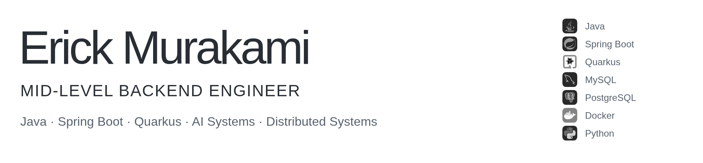

<h1 align="left">
  <picture>
    <source media="(prefers-color-scheme: dark)" srcset="assets/header-dark.png" />
    <source media="(prefers-color-scheme: light)" srcset="assets/header-light.png" />
    
  </picture>
</h1>

<h2 align="left">About Me</h2>

I'm a Backend Engineer specialising in <strong>Java</strong>. I build backend systems and REST APIs with a focus on clear architecture, performance, and maintainability.
  
In my professional work, I develop enterprise applications with <strong>Spring Boot</strong>, relational databases, API integrations, and multi-tenant systems. My main ecosystem is the JVM, particularly <strong>Spring Boot</strong> and <strong>Quarkus</strong>; I also use <strong>Python</strong> for AI, automation, and data-oriented applications.
  
I'm particularly interested in <strong>distributed systems</strong>, <strong>system design</strong>, and <strong>API design</strong>—especially the trade-offs that help software stay simple and reliable as it evolves.

---

<h2 align="left">Tech Stack</h2>

| Area | Technologies & practices |
| --- | --- |
| **Backend** | Java 17 / 21 / 25, Spring Boot, Quarkus, REST APIs |
| **Databases** | PostgreSQL, MySQL, SQL Server, MongoDB |
| **Architecture** | Clean Architecture, Domain-Driven Design, multi-tenancy |
| **AI & Data** | Python, FastAPI, Spring AI, LangChain4j, LLM integrations |
| **Infrastructure & Tools** | Docker, Podman, Git, GitHub, Jira |

---

<h2 align="left">Technologies</h2>

  

---

<h2 align="left">Featured Projects</h2>

<h3><a href="https://github.com/ErickMurakami/Econolyze">Econolyze</a></h3>

Personal finance platform covering accounts, transactions, payments, recurring expenses, and financial goals, with Quarkus services for authentication, finance, an API gateway, and an AI assistant.

<strong>Engineering focus:</strong> Financial domain modelling, service boundaries, and AI integration within a backend application.

Java · Quarkus · PostgreSQL · REST APIs · Clean Architecture · LangChain4j

<h3><a href="https://github.com/ErickMurakami/quarkus-rate-limiter">Quarkus Rate Limiter</a></h3>

API rate limiter implementing fixed and sliding windows with Redis and atomic Lua scripts. Integration tests cover request limits and independent client counters.

<strong>Engineering focus:</strong> Atomic operations under concurrent requests and the trade-off between window precision and storage cost, with OpenTelemetry spans for each check.

Java · Quarkus · Redis · Lua · OpenTelemetry · Integration Testing

<!-- <h3>CreditLens</h3>

AI-assisted credit analysis project exploring document processing, vector search, and LLM-generated financial assessments.
 
<strong>Java • Spring Boot • Spring AI • PostgreSQL • pgvector</strong>

<h3>F1 Data Analysis</h3>

Formula 1 data analysis project built to explore telemetry, race data, and performance insights.
 
<strong>Python • FastF1 • Data Analysis</strong>

 -->

---

<h2 align="left">Education</h2>

  <strong>Higher Education Diploma in Business Informatics</strong> — Fatec Rio Preto 
  <em>Ongoing</em>
    
  <strong>Technical Degree in Information Technology</strong> — Etec Philadelpho Gouvêa Netto

---

<h2 align="left">About My Repositories</h2>

My repositories combine backend applications with focused studies in API design, databases, distributed systems, and AI integrations.
  
I use personal projects to explore architectural decisions and their trade-offs: how data is modelled, where responsibilities belong, and how systems behave beyond the happy path.

---

<h2 align="left">GitHub Activity</h2>

<!-- Cards are refreshed daily by .github/workflows/profile-assets.yml. -->

  <a href="https://github.com/ErickMurakami?tab=overview"><picture><source media="(prefers-color-scheme: dark)" srcset="assets/streak.svg" /><source media="(prefers-color-scheme: light)" srcset="assets/streak-light.svg" /></picture></a>
  <a href="https://github.com/ErickMurakami?tab=repositories"><picture><source media="(prefers-color-scheme: dark)" srcset="assets/top-languages.svg" /><source media="(prefers-color-scheme: light)" srcset="assets/top-languages-light.svg" /></picture></a>

  <a href="https://github.com/ErickMurakami?tab=overview">Contribution activity</a> ·
  <a href="https://github.com/ErickMurakami?tab=repositories">Public repositories</a> ·
  <a href="#featured-projects">Featured projects</a> ·
  <a href="https://www.linkedin.com/in/erick-murakami"> LinkedIn</a> ·
  <a href="https://erickmurakami.github.io/">Portfolio</a>

